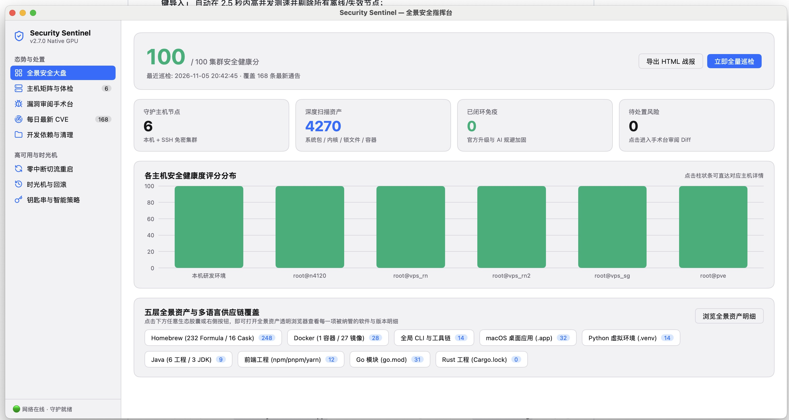
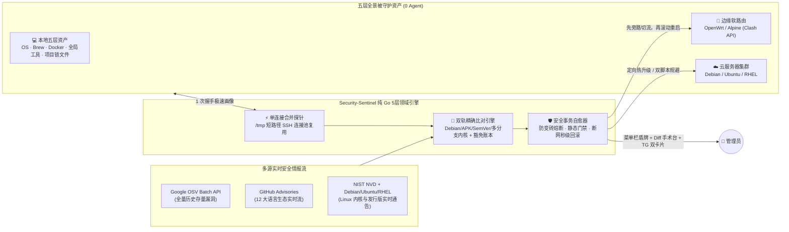

<div align="center">

# 🛡️ Security-Sentinel (安全哨兵)

**不止于报警——专为独立开发者、Homelab 玩家与混合云团队打造的「零代理、原生 GPU、真闭环」基础设施安全管家**

[](https://github.com/sixban6/security-sentinel/releases/latest)
[](https://github.com/sixban6/security-sentinel/actions/workflows/ci.yml)
[](https://go.dev/)
[](https://github.com/egoist/mygo)
[]()
[](LICENSE)

[**为什么需要它 (Why)**](#-why为什么现有的安全工具让你既焦虑又疲惫) · [**30 秒极速上手 (How)**](#-how30-秒极速上手) · [**核心产品体验 (What)**](#-what一核三端的全场景产品体验) · [**底层工程揭秘**](#-底层揭秘为什么能做到快准稳) · [**命令速查 (`sectl`)**](#️-命令行全景速查-sectl) · [**进阶文档**](#-进阶架构指南)

<br/>



<sub>▲ <b>MyGo 原生 GPU 直绘全景安全指挥台</b>：零 WebView / 零 Electron，常驻内存仅 ~15MB，单次并发守护本机五层供应链与跨国 SSH 集群</sub>

</div>

---

## 🎯 WHY：为什么现有的安全工具让你既焦虑又疲惫？

当你手里同时管着 **本地研发 Mac/PC + 家里 OpenWrt 软路由/PVE + 几台跨国云服务器（VPS）** 时，传统安全方案往往陷入四个死胡同：

1. **“只管制造焦虑，不管善后”的告警疲劳**：传统扫描器丢给你一张 500 行的 CVE 表格就结束了；更糟的是把已打满补丁的 Debian LTS `6.1` 内核误判成 `< 6.12` 漏洞，甚至把不想升的跨代系统大版本天天标黄扣分，逼得你最终把告警静音。
2. **被管机器装不起笨重的 Agent**：传统平台要求每台机器部署常驻 Agent，而 OpenWrt 软路由剩余 Flash 往往不到 `30MB`，装个运行时直接写爆闪存变砖；桌面套壳 Electron 客户端挂在后台又要吃掉 `500MB` 内存。
3. **打补丁重启 = 全家/业务断网黑洞**：云端核心节点修完内核一执行 `reboot`，正在走的跨国流量、视频会议、SSH 会话瞬间掉线两分钟。
4. **本地开发环境成了“被遗忘的盲区”**：系统包更新了，但本机的 Homebrew、Docker 容器镜像、全局工具链以及十几个项目里的 `.venv`、`uv.lock`、`pom.xml`、`package-lock.json`、`go.mod`、`Cargo.lock` 里还躺着高危 RCE 依赖。

### 一眼看懂 Security-Sentinel 的降维体验

| 维度 | 传统扫描器 (Trivy / Grype) | 重型企业级 Agent 平台 | **🛡️ Security-Sentinel (`sectl`)** |
| :--- | :--- | :--- | :--- |
| **被管端侵入性** | 需逐台安装运行或挂载镜像 | 需每台部署常驻守护进程 | **100% 零 Agent**（纯 SSH 免密连接池复用，目标机零安装） |
| **桌面端资源开销** | 无桌面端（纯命令行长表格） | Web 控制台或百兆 Electron | **原生 GPU 菜单栏哨兵 + 全景工作台**（空闲内存 **~15MB**，秒开） |
| **资产覆盖广度** | 单一镜像或单一目录 | 侧重服务器系统层 | **五层全景自省**（系统内核 + Homebrew + Docker + 全局工具链 + 9 大语言锁文件） |
| **漏洞处置与人性化** | ❌ 只扫不修，无豁免机制 | ⚠️ 黑盒自动改系统，易翻车 | **双栏代码 Diff 审阅 + 6 路并发升级 + 三档静默豁免（跳过版本/暂缓/永久）** |
| **软路由与高可用** | ❌ 无硬件感知，不管断网 | ❌ 不支持边缘软路由 | **OpenWrt 闪存防变砖硬熔断 + Clash/Mihomo 旁路切流零中断重启** |
| **情报与密钥安全** | 被动查询，明文配置 | 托管第三方云端 | **每日最新 CVE 分类雷达 & TG 独立日报 + 系统钥匙串 (Keychain) 零明文** |

---

## ⚡ HOW：30 秒极速上手

无需安装 Go、Python 或任何编译工具链，直接从 GitHub Actions 官方构建产物一键安装（内置 **SHA-256 签名强校验**，主命令精简为 5 键 **`sectl`**）：

### 1. 一行命令免编译安装
```bash
# macOS 推荐：同时安装 sectl CLI 与原生 GPU 桌面应用 (/Applications/Security Sentinel.app)
curl -fsSL https://raw.githubusercontent.com/sixban6/security-sentinel/main/install.sh | bash -s -- --with-app

# Linux 服务器 / OpenWrt 软路由 / 仅安装 CLI：
curl -fsSL https://raw.githubusercontent.com/sixban6/security-sentinel/main/install.sh | bash
```

### 2. 零打字纳管你的服务器集群
- **桌面端操作**：打开 **`Security Sentinel.app`** ➔ 进入「主机矩阵与体检」➔ 点击 **「从 `~/.ssh/config` 一键导入」**（自动融合 `ssh -G` 配置并流式探测免密连通性，自动筛除离线废节点，勾选即纳管）。
- **命令行操作**：
  ```bash
  sectl init --global --discover
  ```

### 3. 全链路体检、巡检与每日情报订阅
```bash
# 1. 并发校验所有主机的 SSH 免密连通性、提权能力与钥匙串状态
sectl doc

# 2. 执行 100% 安全只读的全量巡检，并生成单文件深色 HTML 战报
sectl audit --html sentinel_report.html

# 3. 查看按「内核 / OS / 语言生态 / 重要性」分类的每日最新 CVE (加 --push 一键推送至 Telegram)
sectl cve
```

> 💡 **后续升级只需 2 个词**：随时执行 `sectl up`（macOS 加 `--app` 同步更新桌面应用），或在桌面端设置页一键热更新重启。

---

## ✨ WHAT：“一核三端”的全场景产品体验

同一套 `CGO_ENABLED=0` 纯 Go 安全引擎，无缝驱动 **菜单栏哨兵**、**全景 GPU 工作台** 与 **极简 CLI / AI 技能** 三种形态：

```text
                ┌────────────────────────────────────────────────────┐
                │        Sentinel Core Engine (Pure Go, 0-CGO)       │
                │  五层全景自省 · OSV+CNA双擎 · Gemini自愈 · HA切流   │
                └─────────┬──────────────────┬─────────────────┬─────┘
                          │                  │                 │
         ┌────────────────▼───┐     ┌────────▼────────┐   ┌────▼───────────────┐
         │ 1. 菜单栏轻量哨兵    │     │ 2. 全景指挥台    │   │ 3. 7.5MB 极速 CLI  │
         │  (Menu Bar Flyout) │     │ (原生 GPU 工作台) │   │ (sectl & AI Skill) │
         └────────────────────┘     └─────────────────┘   └────────────────────┘
```

### 1. 右上角菜单栏无感哨兵 (Menu Bar Flyout)
- **三色盾牌一眼知全局**：不占 Dock 栏，常驻右上角展示 **🟢 绿盾（满分健康）/ 🟡 黄盾（有补丁待审）/ 🔴 红盾（高危暴露）**，支持 **`⌘⇧S`** 全局快捷键秒开毛玻璃卡片；
- **内置可视化智能调度器**：无需外部 `launchd` 脚本，界面内自由切换「每 4/8/12/24 小时定频」、「每日定点（如 09:00）」或「仅手动」，实时展示下次巡检时间；支持笔记本开盖自动补跑（`Power.OnResume`）与手机热点省流保护（`Network.Metered`）。

### 2. 原生 GPU 全景安全指挥台 (7 大核心工作台)
- **📊 全景安全大盘 & 五层资产透明浏览器**：直观展示集群安全分、各节点评分柱状图，以及 **Homebrew (`Formula + Cask`)、Docker (`容器 + 镜像`)、全局工具链、macOS 应用、Python/Java/Node/Go/Rust** 全景胶囊——**点击任意胶囊即可打开 120fps 虚拟列表搜索查看每一项真实纳管软件与版本号**；
- **🖥️ 主机矩阵与智能终端直连**：展示 OpenWrt 内存与 `/overlay` 闪存防变砖水位条；点击 **「打开 SSH 终端」** 自动探测正在运行的 **WezTerm / Ghostty / iTerm2 / Kitty**，自动注入代理隧道环境并在当前窗口新建聚焦标签页直连；
- **🔬 漏洞审阅手术台（Zed 同款双栏 `DiffViewer` + 人性化豁免）**：
  - 并排对比【应急回滚脚本 vs 可编辑加固脚本】，先看清处方再批准执行；
  - 自动剥离跨代系统换代包（如 macOS `_major` 大版本推荐不扣分、不误报）；对暂不想升的组件支持一键 **「⏭️ 跳过此版本 / 💤 暂缓 30 天 / 🔕 永久豁免」**，随时可在「已豁免」标签页一键恢复监控；
- **📡 每日最新 CVE 全球情报中心 + Telegram 独立日报**：按 **语言环境 / 操作系统 (Debian/Ubuntu/RHEL) / Linux 内核 / 重要性 (`CRITICAL`/`HIGH`/`MEDIUM`)** 四维实时筛选全网最新披露 CVE，并支持作为**独立排版的分类日报消息**单独推送至手机 Telegram；
- **💻 开发依赖并发升级与僵尸环境清理**：将静态项目依赖与主机运行安全分彻底解耦，按「近期活跃项目 ➔ 待升级包」两级卡片折叠（支持 `uv pip`、Maven `~/.m2` 传递依赖树穿透解析），提供 **Go 6 路协程池一键并发升级全部项目**、项目安全移入废纸篓、以及孤儿虚拟环境一键清理释放磁盘空间；
- **🔄 零中断切流重启 & ⏪ 时光机一键回滚**：可视化监控 Clash/Mihomo 网关节点延迟，挂载 `KeepAwake` 防休眠锁执行无感滚动重启；所有远程规避脚本永久保留回滚能力，官方补丁就位后自动提醒退役临时规则；
- **🔐 系统钥匙串零明文保险箱**：所有 Token / API Key 加密锁入系统原生 Keychain，Telegram 采用 **6 位一次性配对码** 绑定防陌生人劫持。

### 3. 7.5MB 静态 CLI (`sectl`) & AI Agent 技能
- 零外部依赖单文件交叉编译直跑 macOS / Linux / Windows / **OpenWrt (`mipsle`/`arm64`)**；
- 内置 [`SKILL.md`](SKILL.md)，一键注册为 Google `agy` / Claude Code 的系统级主动安全闭环技能。

---

## 🧠 底层揭秘：为什么能做到“快、准、稳”？



1. **快 10 倍**：建立 `/tmp/ss-<uid>` 私有 `ControlMaster` 连接复用，将环境自省、硬件水位、源码包映射、运行内核、容器镜像压缩为**单次只读流**分段解析，跨国高延迟节点 1~2 秒完成画像。
2. **零误报、零漏报**：内置符合 Debian Policy（含 `epoch` 与 `~` 序）、APK `-rN`、PEP 440、SemVer、FIRST.org CVSS v3.1 向量计算器与 **Linux 内核多 LTS 分支（5.10/5.15/6.1/6.6/6.12）** 的专用比较引擎。
3. **四道生产安全护栏**：`audit` 默认 100% 只读；OpenWrt 内存 `<32MB` / Flash `<30MB` 物理防变砖硬熔断；Gemini 双脚本经 `sh -n`、高危指令黑名单与 BusyBox `ash` 兼容性门禁校验；远端部署后多路探活失联**本地秒级自动回滚** + 连续失败 24 小时熔断锁。

---

## 🛠️ 命令行全景速查 (`sectl`)

> 主命令为 **`sectl`**，安装与升级时自动维护 `security-sentinel` 软链接以保持 100% 向后兼容。

| 命令（含简写） | 核心用途 | 常用示例 |
| :--- | :--- | :--- |
| `sectl audit` (`scan`) | 全集群端到端安全巡检（默认只读；加 `--fix` 自动修补安全包） | `sectl audit`<br/>`sectl audit --html report.html` |
| `sectl cve` (`adv`) | 查看按「语言 / OS / 内核 / 重要性」分类的每日最新 CVE，支持单独推送 TG | `sectl cve`<br/>`sectl cve --category kernel`<br/>`sectl cve --push` |
| `sectl assets` | 五层全景资产清单浏览器（按层级、主机与关键词检索已纳管组件） | `sectl assets --layer docker`<br/>`sectl assets --layer brew -q ssl` |
| `sectl deps` (`ws`) | 按「活跃项目 ➔ 待升级包」两级折叠展示工作区依赖并一键升级 | `sectl deps`<br/>`sectl deps --fix` |
| `sectl mute` / `unmute` | 对暂不升级项配置「跳过版本 / 暂缓 N 天 / 永久豁免」或恢复监控 | `sectl mute --list`<br/>`sectl mute --id CVE-xxx --pkg redis --mode snooze` |
| `sectl clean-venvs` | 扫描原项目已删或长期闲置的孤儿虚拟环境并安全移入系统废纸篓 | `sectl clean-venvs`<br/>`sectl clean-venvs --apply` |
| `sectl doc` (`doctor`) | 并发诊断所有主机 SSH 免密、提权、漏洞源与钥匙串状态 | `sectl doc` |
| `sectl fix` | 预览并定向执行操作系统安全补丁（含 `--dry-run` 模拟模式） | `sectl fix --dry-run` |
| `sectl rb` (`rollback`) | 查看时光机账本，或一键远程回滚已归档的 AI 规避脚本 | `sectl rb --list` |
| `sectl rs` (`reboot-sync`) | Clash/Mihomo 旁路切流 ➔ 串行重启 ➔ 凭据强同步 ➔ 网关重载 | `sectl rs --auto` |
| `sectl init` | 生成配置模板，或从 `~/.ssh/config` 流式筛查导入在线服务器 | `sectl init --global --discover` |
| `sectl pair` | 生成 6 位一次性安全配对码绑定手机 Telegram 机器人 | `sectl pair` |
| `sectl up` (`upgrade`) | 从 GitHub Release 校验 SHA-256 并原子升级至最新版 | `sectl up`<br/>`sectl up --app` |

---

## 📚 进阶架构指南

- ⚙️ [**极简配置与全自动资产画像指南**](docs/configuration-guide.md)
- 🔄 [**零中断平滑切流与高可用滚动自愈**](docs/zero-downtime-ha.md)
- 🐧 [**Linux 内核多 LTS 分支智能研判机制**](docs/kernel-cve-multibranch.md)
- ⏰ [**全自动化定时巡检与唤醒守护指南**](docs/scheduled-scanning.md)
- 🤖 [**AI 多模型自愈引擎与智能体技能联动**](docs/agy-integration.md)

## 📄 开源许可证

本项目采用 [MIT License](LICENSE) 开源协议。
