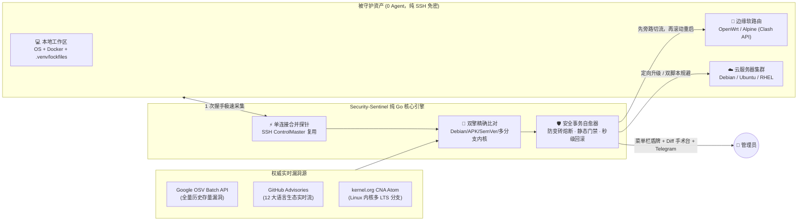

<div align="center">

# 🛡️ Security-Sentinel (安全哨兵)

**不止于报警——专为独立开发者、Homelab 玩家与混合云团队打造的「零代理、原生 GPU、真闭环」基础设施安全管家**

[](https://github.com/sixban6/security-sentinel/releases/latest)
[](https://github.com/sixban6/security-sentinel/actions/workflows/ci.yml)
[](https://go.dev/)
[](https://github.com/egoist/mygo)
[]()
[](LICENSE)

[**为什么需要它 (Why)**](#-why为什么现有的安全工具让你既焦虑又疲惫) · [**核心产品形态 (What)**](#-what一核三端的全场景体验) · [**30 秒极速上手**](#-30-秒极速上手) · [**硬核工作原理 (How)**](#-how它是如何做到快准稳的) · [**命令速查**](#️-命令行全景速查) · [**深度文档**](#-进阶架构指南)

</div>

---

## 🎯 WHY：为什么现有的安全工具让你既焦虑又疲惫？

当你手里同时管着 **本地研发电脑 + 家里 OpenWrt 软路由/PVE + 几台跨国云服务器（VPS）** 时，传统安全方案往往会陷入四个死胡同：

1. **“只管制造焦虑，不管善后”的告警轰炸**：传统扫描器丢给你一张 500 行的 CVE 表格就结束了；更糟的是把已打满补丁的 Debian LTS `6.1` 内核误判成 `< 6.12` 高危漏洞，几次狼来了之后，你干脆把告警静音了。
2. **被管机器装不起笨重的 Agent**：传统监控需要在每台机器装常驻 Agent，而 OpenWrt 软路由剩余 Flash 往往不到 `30MB`，装个运行时直接写爆闪存变砖；桌面套壳 Electron 客户端挂在后台又要吃掉 `500MB` 内存。
3. **打补丁重启 = 全家/业务断网黑洞**：云端核心节点修完内核一执行 `reboot`，正在走的跨国流量、视频会议、SSH 连接瞬间掉线两分钟。
4. **本地项目的虚拟环境成了“隐形雷区”**：系统软件更新了，但本地工作区十几个项目里的 `.venv`、`package-lock.json`、`pnpm-lock.yaml`、`go.mod`、`Cargo.lock` 里还静静躺着半年前的 RCE 高危依赖。

### 一眼看懂 Security-Sentinel 的不同

| 维度 | 传统漏洞扫描器 (Trivy / Grype) | 重型企业级 Agent 平台 | **🛡️ Security-Sentinel v2.0** |
| :--- | :--- | :--- | :--- |
| **被管端侵入性** | 需逐台安装运行或挂载镜像 | 需每台部署常驻守护进程 | **100% 零 Agent**（纯 SSH 免密连接复用，目标机零安装） |
| **桌面端资源开销** | 无桌面端（纯命令行长表格） | Web 控制台或百兆 Electron | **原生 GPU 直绘菜单栏哨兵**（空闲内存 **~15MB**，毫秒级秒开） |
| **内核与生态精准度** | 常因 LTS 分支号低产生海量误报 | 依赖商业规则库 | **OSV 全量存量库 + GHSA + Linux 多 LTS 分支精准对齐** |
| **漏洞处置闭环** | ❌ 只扫不修，全靠手工查文档 | ⚠️ 黑盒自动改系统，易翻车 | **先看双栏代码 Diff 处方再批准执行 + 断网秒级自动回滚** |
| **软路由与重启保护** | ❌ 无硬件感知，不管业务中断 | ❌ 不支持边缘软路由 | **OpenWrt 闪存防变砖熔断 + Clash/Mihomo 旁路切流滚动重启** |
| **密钥与告警安全** | 明文配置文件或环境变量 | 托管于第三方云端 | **系统硬件级钥匙串 (Keychain) 加密 + Telegram 6 位配对码防劫持** |

---

## ✨ WHAT：“一核三端”的全场景体验

`Security-Sentinel v2.0` 基于 `CGO_ENABLED=0` 纯 Go 引擎重写，将同一套安全大脑无缝投射为三种交互形态：

```text
                ┌────────────────────────────────────────────────────┐
                │        Sentinel Core Engine (Pure Go, 0-CGO)       │
                │  SSH单连接极速探针 · OSV全量引擎 · Gemini自愈 · HA切流 │
                └─────────┬──────────────────┬─────────────────┬─────┘
                          │                  │                 │
         ┌────────────────▼───┐     ┌────────▼────────┐   ┌────▼───────────────┐
         │ 1. 菜单栏轻量哨兵    │     │ 2. 全景指挥台    │   │ 3. 7.5MB 静态 CLI  │
         │  (Menu Bar Flyout) │     │ (原生 GPU 工作台) │   │ (终端/软路由/Agent) │
         └────────────────────┘     └─────────────────┘   └────────────────────┘
```

### 1. 日常 90% 的时间：无感驻留的菜单栏哨兵 (Menu Bar App)
- **不占 Dock 栏，一眼知全局**：常驻右上角菜单栏，通过 **🟢 绿盾（全集群健康）/ 🟡 黄盾（有安全补丁待装）/ 🔴 红盾（发现高危暴露）** 动态展示集群安全分（`0~100`）；
- **`⌘⇧S` 全局秒开毛玻璃卡片**：在任何全屏应用下按下快捷键即可呼出悬浮窗，查看每台机器实时延迟、一键无损安装官方安全补丁；
- **物理世界感知**：合盖休眠唤醒后自动补跑错过的巡检（`Power.OnResume`）；连手机个人热点时自动切换省流模式（`Network.Metered`）；点击系统通知横幅直接跳转到对应漏洞处方页。

### 2. 深度排障与审批：MyGo 原生 GPU 全景安全指挥台 (Mission Control)
零 HTML/JS/WebView，由 Metal (macOS) / Direct3D 11 (Windows) / OpenGL (Linux) 在 GPU 上原生渲染 6 大专业视图：
- **📊 全景安全大盘**：集群健康分、4 维核心指标、各主机评分交互柱状图与多语言供应链雷达（`.venv` / `npm` / `go.mod` / `Cargo.lock` / `Docker`）；
- **🖥️ 主机矩阵与一键体检**：直观展示 OpenWrt 内存与 `/overlay` 闪存防变砖水位条；点击 **「打开 SSH 终端」** 自动识别你正在使用的 **WezTerm / Ghostty / iTerm2 / Kitty** 并在当前窗口新建标签页直连；点击 **「从 `~/.ssh/config` 一键导入」** 自动在 2.5 秒内高并发测速并剔除所有离线/失效节点；
- **🔬 漏洞审阅手术台（Zed 同款双栏 `DiffViewer`）**：左侧筛选高危风险，右侧上方以 Markdown 呈现机理分析，下方并排对比 **【应急回滚脚本 vs 拟执行加固脚本】**——支持直接在代码编辑器内微调修改，确认无误后再点「批准并远程执行」；
- **🔄 零中断切流重启控制台**：可视化展示边缘网关（Clash/Mihomo）活跃节点与延迟，滚动重启云端节点期间自动挂载系统 **`KeepAwake` 防休眠锁**，实时滚动四阶段恢复日志；
- **⏪ 时光机账本与一键回滚**：所有历史补丁与 `/etc/sentinel/remediations/` 现场规避记录一目了然，支持随时一键远程回滚；当上游正式补丁发布并安装后，自动提醒**一键清理过时的临时规避规则**；
- **🔐 钥匙串保险箱**：Telegram Token、Gemini/OpenAI/Anthropic Key、GitHub Token 全部锁入系统原生 Keychain，磁盘 `sentinel.yaml` **100% 零敏感明文**。

### 3. 自动化与边缘节点：7.5MB 零依赖极简 CLI (`sectl`) & AI 技能
- **5 键极速短命令 `sectl`**（同时自动保留 `security-sentinel` 软链做 100% 向后兼容），单文件直跑 `darwin` / `linux` / `windows` / `openwrt (mipsle/arm64)`；
- 仓库内置 [`SKILL.md`](SKILL.md)，可一键挂载为 Google `agy` / Claude Code 等 AI 智能体的主动安全巡检与自愈技能。

---

## ⚡ 30 秒极速上手

无需安装 Go、Python 或任何编译环境，直接从 GitHub Actions 官方构建产物一键安装（内置 **SHA-256 签名强校验**）：

### 第一步：一行命令安装
```bash
# macOS 推荐：同时安装 sectl CLI 与原生 GPU 桌面应用 (/Applications/Security Sentinel.app)
curl -fsSL https://raw.githubusercontent.com/sixban6/security-sentinel/main/install.sh | bash -s -- --with-app

# Linux 服务器 / OpenWrt 软路由 / 仅安装 sectl CLI：
curl -fsSL https://raw.githubusercontent.com/sixban6/security-sentinel/main/install.sh | bash
```

### 第二步：零打字纳管你的服务器集群
方式 A（桌面端）：打开 **`Security Sentinel.app`** ➔ 进入「主机矩阵与体检」➔ 点击 **「从 `~/.ssh/config` 一键导入」** 勾选在线机器即可。  
方式 B（命令行）：自动扫描本机 `~/.ssh/config`、并发剔除离线废节点并生成全局配置：
```bash
sectl init --global --discover
```

### 第三步：全链路体检与首次安全巡检
```bash
# 1. 并发校验所有主机的 SSH 免密连通性、提权能力与情报源状态
sectl doc

# 2. 执行 100% 安全只读的全量巡检，并生成深色主题单文件 HTML 战报
sectl audit --html sentinel_report.html
```

> 💡 **日后升级同样只需 2 个词**：执行 `sectl up`（macOS 加 `--app` 同步更新桌面端），或直接在桌面端设置页点击「检查新版本 ➔ 一键升级」。

---

## 🧠 HOW：它是如何做到“快、准、稳”的？



1. **为什么快 10 倍？（单次握手合并探针 + 连接池复用）**  
   摒弃传统工具每查一项指标新建一次 SSH 连接的做法，自动建立 `/tmp/ss-<uid>` 私有 `ControlMaster` 复用通道，并将发行版识别、硬件容量、系统包、源码包映射、运行内核、容器列表压缩为**单次只读流**分段解析，跨国高延迟节点也能在 1~2 秒内完成画像。
2. **为什么不误报、不漏报？（存量 OSV + 增量 CNA + 发行版版本语义）**  
   内置符合 Debian Policy（支持 `epoch` 与 `~` 预发布序）、Alpine/OpenWrt `-rN`、PEP 440、SemVer 以及 **Linux 内核多 LTS 分支（5.10 / 5.15 / 6.1 / 6.6 / 6.12）** 的专用版本比较器；既用 Google OSV 批量接口兜底半年前的老旧漏洞依赖，又用实时流捕获今天刚披露的 0-Day。
3. **为什么敢在生产环境自愈？（四道刚性安全护栏）**  
   - **护栏一（默认只读）**：`audit` 绝不擅自改机器；系统更新统一走 `--no-remove --only-upgrade` 杜绝级联卸载业务包；  
   - **护栏二（硬件防变砖锁）**：探测到 OpenWrt 可用内存 `<32MB` 或 Flash `/overlay <30MB` 时自动进入熔断锁定，严禁在线写爆闪存；  
   - **护栏三（Gemini 双脚本静态门禁）**：针对尚无官方补丁的高危漏洞，默认调用 Gemini 生成配对的【加固脚本 + 回滚脚本】，先过 `sh -n`、高危指令黑名单与 BusyBox `ash` 语法兼容性检查；  
   - **护栏四（断网秒级自回滚 + 熔断账本）**：远端执行加固后立即在目标机本地探测多路公网连通性，一旦失联**目标机本地立即自动执行回滚脚本恢复网络**，连续失败自动锁定 24 小时冷却期。

---

## 🛠️ 命令行全景速查 (`sectl`)

> 所有命令均以精简的 **`sectl`** 为主入口，同时 `install.sh` 自动建立 `security-sentinel` 软链接，旧脚本与定时任务 100% 无缝兼容。

| 命令（含简写） | 核心用途 | 常用示例 |
| :--- | :--- | :--- |
| `sectl audit` (`scan`) | 全集群端到端安全巡检（含 Apple macOS 系统更新、Linux 内核与服务） | `sectl audit`<br/>`sectl audit --fix --auto-reboot` |
| `sectl cve` (`adv`) | 查看按「语言环境 / OS / 内核 / 重要性」分类的每日最新 CVE，支持单独推送 Telegram 日报 | `sectl cve`<br/>`sectl cve --category kernel`<br/>`sectl cve --push` |
| `sectl deps` (`ws`) | 按「活跃项目 ➔ 待升级包」两级折叠展示工作区依赖并支持一键升级 | `sectl deps`<br/>`sectl deps --fix` |
| `sectl clean-venvs` | 扫描原目录已删或闲置多年的孤儿虚拟环境并安全移入系统废纸篓 | `sectl clean-venvs`<br/>`sectl clean-venvs --apply` |
| `sectl doc` (`doctor`) | 并发诊断所有主机 SSH 免密、提权、漏洞源与钥匙串 | `sectl doc` |
| `sectl fix` | 定向安装操作系统与基础库安全补丁（支持预览） | `sectl fix --dry-run`<br/>`sectl fix --hosts node-alpha` |
| `sectl rb` (`rollback`) | 查看时光机账本，或一键远程回滚已归档的规避脚本 | `sectl rb --list`<br/>`sectl rb --host node-alpha --cve CVE-2025-xxxx` |
| `sectl rs` (`reboot-sync`) | Clash/Mihomo 旁路切流 ➔ 串行重启 ➔ 凭据强同步 | `sectl rs --auto` |
| `sectl rep` (`report`) | 导出零外部资源依赖的深色主题单文件 HTML 审计战报 | `sectl rep --html report.html` |
| `sectl init` | 生成配置模板，或从 `~/.ssh/config` 自动筛查导入主机 | `sectl init --global --discover` |
| `sectl pair` (`telegram-pair`) | 生成 6 位一次性配对码安全绑定手机 Telegram Bot | `sectl pair` |
| `sectl sched` (`schedule`) | 一键配置/查看/卸载系统级定时巡检 (`launchd` / `cron`) | `sectl sched "0 9 * * *"` |
| `sectl mem` (`memory`) | 查看或清理分层缓存、Markdown 知识库与熔断账本 | `sectl mem`<br/>`sectl mem --clean all` |
| `sectl up` (`upgrade`) | 从 GitHub Release 校验 SHA-256 并原子升级至最新版 | `sectl up`<br/>`sectl up --app` |

### 极简配置预览 (`~/.config/sentinel/sentinel.yaml`)

所有敏感 Token 均保存在系统钥匙串中，配置文件干净到只需列出主机地址：

```yaml
hosts:
  - root@1.2.3.4
  - name: "生产 Web 节点"
    user: ubuntu
    host: 5.6.7.8
    port: 2222

auto_fix:
  enabled: false          # 默认安全只读；设为 true 或传 --fix 开启无损系统补丁自愈

ai_remediation:
  enabled: false          # 开启后对无官方补丁的高危 CVE 启动 Gemini 可行性研判与双脚本规避
  provider: "gemini"      # gemini (默认) | agy | openai | anthropic
```

---

## 📚 进阶架构指南

- ⚙️ [**极简配置与全自动资产画像指南**](docs/configuration-guide.md) — 详解配置优先级、非标端口与多工作区依赖发现
- 🔄 [**零中断平滑切流与高可用滚动自愈**](docs/zero-downtime-ha.md) — 详解软路由 Clash/Mihomo 流量排空与互备节点强同步
- 🐧 [**Linux 内核多 LTS 分支智能研判机制**](docs/kernel-cve-multibranch.md) — 详解如何彻底终结跨分支内核误报
- ⏰ [**全自动化定时巡检与唤醒守护指南**](docs/scheduled-scanning.md) — 详解 `launchd`、`crontab`、`systemd.timer` 最佳实践
- 🤖 [**AI 多模型自愈引擎与智能体技能联动**](docs/agy-integration.md) — 详解双脚本防断网回滚与 `SKILL.md` 智能体挂载

---

## 🛠️ 从源码构建（开发者）

需要 Go `1.27+`（构建桌面端可选安装 `mygo` CLI）：

```bash
git clone https://github.com/sixban6/security-sentinel.git
cd security-sentinel

# 编译零依赖 CLI + 原生 GPU 桌面安装包
./install.sh --from-source

# 运行全量单元测试与无头 GPU 视图交互测试
go test -v ./...
```

## 📄 开源许可证

本项目采用 [MIT License](LICENSE) 开源协议。
