# ⚙️ 极简配置与全自动指纹画像指南 (Configuration & Auto-Discovery)

> 坚持“配置极简、程序全自动”的设计哲学：用户仅需提供 SSH 机器地址，其余所有技术参数全部由程序自动探测生成。

---

## 1. 核心设计原则：用户配置 vs. 程序生成

很多传统运维工具要求用户手动填写极其冗余的配置（如每台机器是 Debian 还是 CentOS、用 apt 还是 yum、装了什么软件等）。
**Security-Sentinel 彻底颠覆了这种繁琐做法**：

```mermaid
flowchart LR
    subgraph UserInput["👤 用户仅需填写的 (sentinel.yaml)"]
        H1["root@1.2.3.4"]
        H2["ubuntu@5.6.7.8"]
        H3["debian@vps-node"]
    end

    subgraph AutoDiscovery["🤖 Sentinel 全自动探测生成的"]
        OS["操作系统发行版 (Debian / Ubuntu / OpenWrt / Alpine 等)"]
        PKG["包管理器清单 (dpkg / apk / pacman / rpm)"]
        KRN["真实运行内核与构建号 (/proc/version / uname -r)"]
        BIN["核心二进制版本 (sing-box, caddy, nginx, docker, curl...)"]
        DOC["运行中的 Docker 容器与其镜像版本 (docker ps)"]
        FLG["系统待重启标志 (/var/run/reboot-required)"]
    end

    UserInput -->|"首轮 SSH 免密探针"| AutoDiscovery
    AutoDiscovery -->|"自动落盘人类可读画像"| OutYAML["~/.config/sentinel/discovered_inventory.yaml"]
```



---

## 2. 配置文件位置与优先级

Sentinel 会按以下优先级顺序自动查找配置文件：

1. **命令行参数指定**：`security-sentinel audit --config /path/to/my_config.yaml`
2. **环境变量指定**：`export SENTINEL_CONFIG=/path/to/my_config.yaml`
3. **当前工作目录**：`./sentinel.yaml` (或 `./sentinel.yml`)
4. **全局用户配置目录**：`~/.config/sentinel/sentinel.yaml` (**推荐，任意终端目录均生效**)
5. **AGY/Gemini 配置目录**：`~/.gemini/config/sentinel.yaml`
6. **项目根目录**：自动在代码安装目录下查找 `sentinel.yaml`

---

## 3. `sentinel.yaml` 极简书写规范

### 方式 A：单行字符串极简格式（最推荐）
无需任何复杂嵌套，直接列出用户名与主机 IP（或 `~/.ssh/config` 中的别名）：
```yaml
hosts:
  - root@1.2.3.4
  - ubuntu@192.168.1.100
  - debian@my-vps-alias
```

### 方式 B：对象格式（支持自定义显示标签）
如果您想为服务器设置更具可读性的中文别名：
```yaml
hosts:
  - name: "生产 Web 节点"
    user: root
    host: 1.2.3.4

  - name: "开发测试机"
    user: ubuntu
    host: 5.6.7.8
    port: 2222       # 支持非标 SSH 端口
```

> [!NOTE]
> **关于本机**：系统默认会自动将【本机研发环境】纳入审计范围，无需您在 `hosts` 中重复编写。

---

## 4. SSH 密钥免密准备

远程主机默认通过标准 SSH 密钥（`ssh -o BatchMode=yes`）无密码交互访问。
在首次使用前，确保已将本地公钥推送至目标机器：

```bash
# 拷贝公钥至远程主机
ssh-copy-id user@your-server-ip

# 验证免密是否成功 (若直接输出主机名则说明配置就绪)
ssh user@your-server-ip "hostname"
```

---

## 5. 可选进阶开关配置

除 `hosts` 必填清单外，`sentinel.yaml` 还支持以下按需开启的进阶特性块：

### 5.1 AI 智能体现场加固 (`ai_remediation`)
```yaml
ai_remediation:
  enabled: false                   # 是否开启无补丁高危漏洞的 AI 现场推理规避 (默认 false)
  model: "gemini-3.8-flash-high"   # 本地 Google agy AI 模型
  auto_execute: false              # 自动通过 SSH 下发执行加固脚本 (默认 false，仅审核)
```
> [!NOTE]
> 开启此开关需确保本机已安装并登录 Google `agy` 命令行 (`which agy`)。详见 [Google agy 联动指南](agy-integration.md)。

### 5.2 旁路网关切流与平滑滚动重启 (`gateway` & `rolling_nodes`)
用于核心代理网关与多节点滚动重启免断网。详见 [零中断平滑切流指南](zero-downtime-ha.md)。

---

## 6. 辅助配置管理命令

系统提供了两个开箱即用的指令协助管理配置：

### 1. `security-sentinel init`：一键初始化配置
```bash
# 在当前目录下生成 sentinel.yaml 模板
security-sentinel init

# 或在全局路径 ~/.config/sentinel/sentinel.yaml 下生成 (推荐)
security-sentinel init --global
```

### 2. `security-sentinel config`：查看当前生效的主机清单
```bash
security-sentinel config
```
终端会清晰展示当前生效的配置文件绝对路径，以及纳管的主机清单。

### 3. `security-sentinel inventory`：查看全自动生成的机器全景画像
```bash
# 直接以清晰可读的 YAML 格式打印全集群机器画像
security-sentinel inventory

# 或输出 JSON 供第三方系统消费
security-sentinel inventory --json
```
自动生成的完整资产画像文件位于：
`~/.gemini/logs/security_audit/discovered_inventory.yaml`

---

## 7. 定时巡检与无人值守自动化

若需配置每日定时自动执行巡检、AI 动态自愈并向 macOS 桌面与 Telegram 推送告警汇报，请参阅：
👉 [⏰ 全自动化定时巡检与守护指南](scheduled-scanning.md)

指南内详细提供了：
* **macOS 首选方案**：`launchd` LaunchAgent 配置（支持电脑休眠唤醒补跑与 100% 弹出通知中心横幅）
* **Linux / 通用方案**：`crontab` 环境变量规范配置
* **Linux 生产服务**：`systemd.timer` 定时服务
* **Google `agy` 联动**：`/schedule` 语义化定时指令
