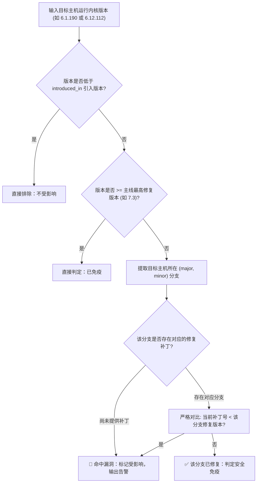

# 🐧 Linux 内核漏洞与多 LTS 分支智能研判机制 (Kernel Vulnerability Engine)

> 解决传统安全扫描器在 Linux 内核上大面积误报的行业难题，精准对齐官方 LTS 维护分支补丁线。

---

## 1. 为什么传统工具在 Linux 内核上必然误报？

Linux 内核与普通的 Python/npm 库有着本质区别：
- 普通库（如 `requests` 或 `lodash`）通常只有一条主线，漏洞修复发布在 `2.31.0`，那么 `< 2.31.0` 全都是漏洞版本；
- **Linux 内核则采用“多 LTS 维护分支长期并行”机制**：
  官方目前活跃维护着 `5.10`、`5.15`、`6.1`、`6.6`、`6.12`、`6.18` 等多个大版本。

### 🚨 经典误报案例分析 (CVE-2026-98432)
以高危在野 Linux TCP 栈提权漏洞 **CVE-2026-98432** 为例：
官方在各个 LTS 分支同步发布了安全补丁：
- `5.10` 分支：修复于 `5.10.272`
- `6.1` 分支（Debian 12 默认）：修复于 `6.1.190`
- `6.6` 分支：修复于 `6.6.159`
- `6.12` 分支（OpenWrt 现代内核）：修复于 `6.12.113`

> **传统扫描器的致命错误**：
> 传统工具通常只能从 CVE 描述中抓取到最后一个修复版本（如 `< 6.12.113`）。
> 如果拿 `< 6.12.113` 去比对一台运行 Debian 12 并且内核已打满补丁的机器（`6.1.190`）：
> 因为在版本号上 `6.1.190 < 6.12.113`，**传统工具会严重误报该机器受影响**！导致管理员被虚假警报轰炸，或者错误地盲目跨大版本升级内核导致系统崩溃。

---

## 2. Sentinel 的多 LTS 分支智能匹配算法

Sentinel 的核心算法位于 [`internal/scan/version/version.go` 中的 `IsKernelVulnerable()`](../internal/scan/version/version.go)：

### 实测比对矩阵：
| 待检测主机 | 运行内核版本 | 匹配对应的 LTS 分支 | 该分支最小修复版本 | 最终判定结论 | 判定解析 |
| :--- | :--- | :--- | :--- | :--- | :--- |
| **本机 (macOS)** | Darwin 24.6.0 | - | - | ✅ **一切安全** | 非 Linux 操作系统，从源头彻底隔离 |
| **云服务器 (Debian 12)** | `6.1.190` | `6.1` 分支 | `6.1.190` | ✅ **一切安全** | `6.1.190 >= 6.1.190`，精准识别为已打补丁 |
| **老旧 VPS (Debian 12)** | `6.1.189` | `6.1` 分支 | `6.1.190` | 🚨 **还未免疫** | `6.1.189 < 6.1.190`，精准命中漏洞，提示升级 |
| **软路由 (OpenWrt)** | `6.12.112` | `6.12` 分支 | `6.12.113` | 🚨 **还未免疫** | `6.12.112 < 6.12.113`，准确告警，等待上游固件发版 |
| **前沿主线机 (Linux)** | `7.4.0` | `7.4` 分支 | `7.3` (主线) | ✅ **一切安全** | 高于主线修复版本，天然免疫 |

---

## 3. 情报源：官方 Linux CNA 实时流对接

除了预置高危在野漏洞基线，Sentinel 还实时对接 Linux 内核官方 CNA（kernel.org）的 Atom RSS 源：
- **官方数据流地址**：`https://lore.kernel.org/linux-cve-announce/new.atom`
- **解析特点**：
  1. 纯标准库 XML 解析，零额外依赖；
  2. 自动正则提取通告正文中的 `Issue introduced in x.x` 引入区间；
  3. 自动正则提取所有列出的 `fixed in x.x.x` 分支修复号；
  4. 自动检测 Use-After-Free、Arbitrary Code Execution、Privilege Escalation 等关键词，自动定级为 `CRITICAL` / `HIGH`。
