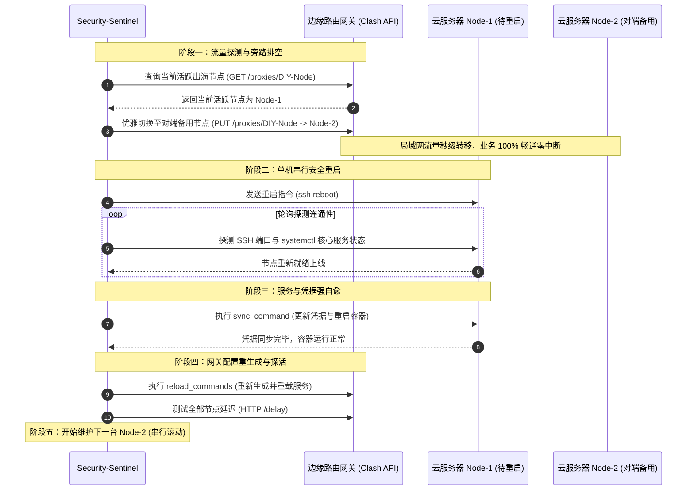

# 🔄 零中断平滑切流与高可用自愈 (Zero-Downtime HA & Rolling Self-Healing)

> 解决服务器打补丁重启时造成的断网黑洞痛点，实现企业级的无感热维护与节点强同步。

---

## 1. 为什么需要零中断平滑切流？

在典型的混合云与代理出海、跨国节点网络中，通常采用 **“边缘路由器/本地网关 + 多台云端 VPS 节点”** 的架构：

- **传统粗暴维护的痛点**：
  当云端某台 VPS 升级了 Linux 内核或核心系统库（如修复 `CVE-2026-98432`）需要重启时，如果直接执行 `reboot`：
  1. 当前正通过该节点传输数据的局域网设备（会议、直播、下载、远程 SSH 连接）会瞬间陷入长达 1~2 分钟的**断网黑洞**；
  2. 如果集群多台 VPS 同时重启，会导致局域网全盘瘫痪；
  3. 重启后如果容器缓存、节点证书未同步，可能导致订阅失效或密钥不一致。

- **Sentinel 的解决方案**：
  将重启过程拆解为严格受控的四阶段闭环：**流量旁路预排空 ➔ 严格单机串行滚动 ➔ 节点凭证强同步 ➔ 网关重载探活**。

---

## 2. 核心工作流与架构图



---

## 3. 配置文件详解

在 `sentinel.yaml` 中，通过以下两个模块配置平滑切流与自愈流水线：

```yaml
# ==============================================================================
# 网关与平滑切流配置 (Proxy Gateway)
# ==============================================================================
gateway:
  # 是否开启网关切流与重载。若为普通云服维护，设为 false 即可
  enabled: true

  # 网关管理地址 (通常为软路由或边缘网关的 SSH 地址)
  ssh_host: root@192.168.1.1

  # Clash / Mihomo 控制器 RESTful API 根地址
  clash_api_url: http://192.168.1.1:9090

  # 需要切流的代理策略组 (Selector Group) 名称
  selector_group: DIY-Node

  # 全部节点维护完成后，在网关上执行的重载命令
  reload_commands:
    - singctl sb gen       # 重新拉取最新订阅并生成客户端配置
    - singctl sb restart   # 平滑重启 sing-box 服务

# ==============================================================================
# 滚动重启节点与备用对端映射 (Rolling Reboot Nodes)
# ==============================================================================
rolling_nodes:
  - id: node_us
    ssh_host: root@1.2.3.4
    keywords: [edge_us_west_vless, edge_us_west_hy2]   # 该节点在网关代理池里的特征关键词
    peer: node_la                                      # 它的对端备用伙伴是谁 (互为备份)
    sync_command: singctl sr ss && docker restart sub-store  # 重启后的强同步指令

  - id: node_la
    ssh_host: root@5.6.7.8
    keywords: [edge_us_south_vless, edge_us_south_hy2]
    peer: node_us
    sync_command: singctl sr ss && docker restart sub-store
```

### 关键配置项说明：

| 配置字段 | 含义说明 | 生产最佳实践 |
| :--- | :--- | :--- |
| `peer` | **互备伙伴节点** | A 节点的流量切给 B，B 节点的流量切给 A，形成无死锁自愈环 |
| `keywords` | **节点识别关键词** | 用于从网关所有节点（可能数十个）中快速筛选出属于该 VPS 的代理节点 |
| `sync_command` | **重启后自愈命令** | 机器启动就绪后自动执行，例如重新生成节点凭证、同步到 Sub-Store 并热重启容器 |
| `selector_group` | **主流量选择器** | 软路由或客户端中的主选节点组（如 `PROXY` 或 `DIY-Node`） |

---

## 4. 命令行独立使用

除了在 `security-sentinel audit --auto-reboot` 中全自动触发外，您也可以单独使用 `reboot-sync` 子命令执行维护：

```bash
# 1. 自动检测集群中有哪些机器存在 /var/run/reboot-required，并自动执行平滑滚动重启
security-sentinel reboot-sync --auto

# 2. 手工指定维护某台或多台机器（严格串行滚动维护，绝不同时离线）
security-sentinel reboot-sync --targets node_us,node_la

# 3. 仅在网关上强制重载配置并进行节点延迟探针测试
security-sentinel reboot-sync --force-gateway
```

---

## 5. 常见问题 (FAQ)

### Q1: 如果我只有一台 VPS，没有对端备用节点怎么办？
> **答**：如果您只有单台 VPS，系统在探测到没有可切流的备用节点时，会打印警告并安全执行单台重启，但无法保证无感切流。建议至少两台节点互为 `peer` 伙伴。

### Q2: 如果我只是普通 Linux 服务器运维，不玩软路由和代理切流怎么办？
> **答**：非常简单！在 `sentinel.yaml` 中保持默认的 `gateway: enabled: false` 和 `rolling_nodes: []` 即可。Sentinel 会专注于漏洞情报拉取与资产交叉比对，完全不干扰您的现有网络。
